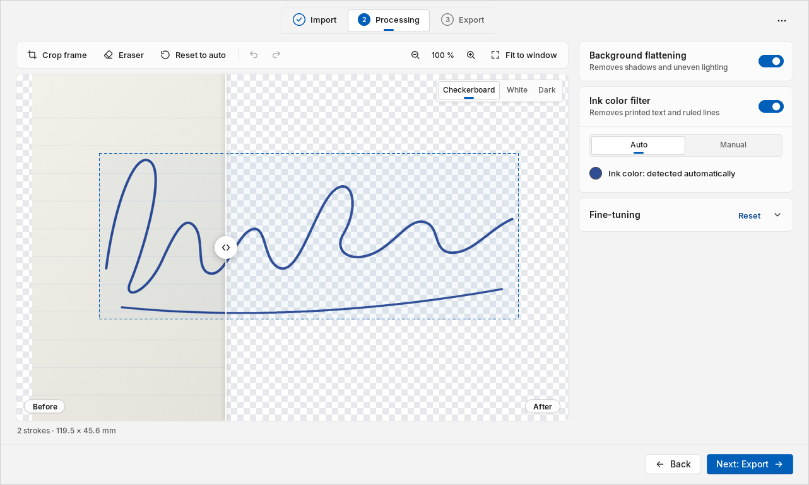
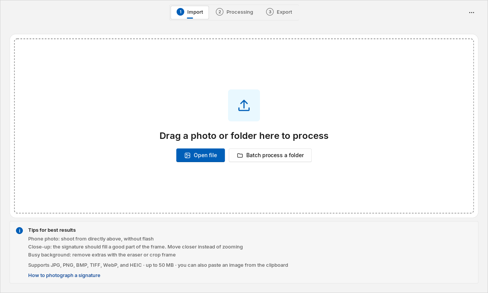
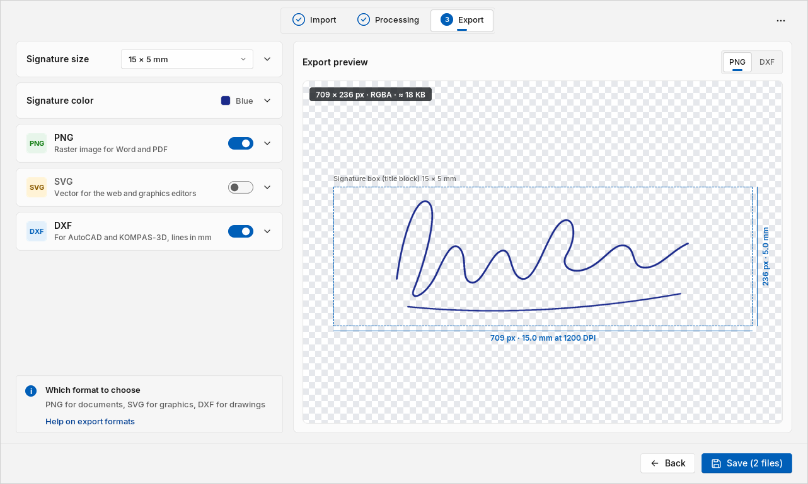
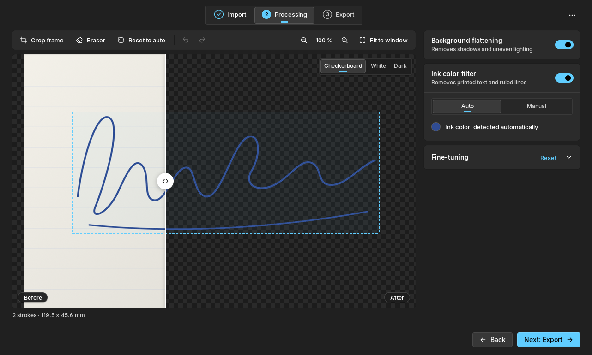

**English** | [Русский](README.ru.md)

<p align="center">
  
</p>

<h1 align="center">Signature Extractor</h1>

<p align="center">Turns a photo or scan of a signature into a clean PNG, SVG or DXF file with no background.</p>

<p align="center">
  <a href="https://github.com/stanislau-salavei/signature-extractor/releases/latest"></a>
  <a href="https://github.com/stanislau-salavei/signature-extractor/releases"></a>
  <a href="https://github.com/stanislau-salavei/signature-extractor/actions/workflows/build-installer.yml"></a>
  <a href="LICENSE"></a>
  
</p>

<p align="center">
  <a href="https://github.com/stanislau-salavei/signature-extractor/releases/latest"></a>
</p>

<p align="center"></p>

## How to use

1. **Import.** Drag a photo or a folder into the window, click **Open file**, or paste an image with Ctrl+V. Supported: JPG, PNG, BMP, TIFF, WebP and HEIC, up to 50 MB.
2. **Processing.** The app separates the signature from the background, shadows, ruled lines and other text. If needed, adjust the frame, erase anything extra, or tune the filters.
3. **Export.** Choose the formats, the signature color and size, then save the files.

| 1. Import | 2. Processing | 3. Export |
|:---:|:---:|:---:|
|  |  |  |

Many photos at once: select several files or a whole folder, and they are processed as one batch. Light and dark themes follow Windows or can be set in Settings.

<details>
<summary>Dark theme</summary>
<p></p>
</details>

## Formats

| Format | What you get | Use for |
|---|---|---|
| **PNG** | Raster image with a transparent background, 300, 600 or 1200 DPI (1200 by default) | Word, Excel, PDF, scans, email |
| **SVG** | Vector, stays sharp at any zoom; size stored in millimeters; strokes as in the original or a set thickness (0.18 mm by default) | Inkscape, CorelDRAW, Illustrator, Word 2016 and later, the web |
| **DXF** | Lines of the chosen thickness, in millimeters | AutoCAD, KOMPAS-3D, nanoCAD, BricsCAD and other apps that read DXF |

- **Size:** as in the original, **15 × 5 mm** (the signature box of a drawing title block, by default), or your own size in millimeters, which you can save as a template.
- **Color:** as in the photo, black, blue, ink blue, bright blue, or your own color.

## System requirements

- Windows 10 version 1809 or later, or Windows 11, 64-bit.
- No administrator rights needed: the app is installed for your account only, in `%LOCALAPPDATA%\Programs\Signature Extractor`.
- Installer about 46 MB.

## FAQ

**Windows says "Windows protected your PC". Is that normal?**
Yes. The installer is not digitally signed, so Microsoft Defender SmartScreen may warn about it. Click **More info** → **Run anyway**. Each release lists the SHA-256 checksum of the installer (in the `.sha256` file and in the release notes), so you can check the download.

**Does the app send my signatures anywhere?**
No. All photos are processed on your PC. The app doesn't send anything to the internet. It only goes online for updates.

**How do updates work?**
If **Check for updates on startup** is on in Settings (it is by default; the check runs at most once a day), or when you click **Check now**, the app looks for a new release here on GitHub. Click **Download** and the app downloads the installer, verifies its SHA-256 checksum and installs the update. Your settings are kept.

**How do I report a problem?**
Use **⋯ › Settings › Report an issue** in the app: it opens a new GitHub issue with the app version, Windows version and language already filled in. You can also [open an issue](https://github.com/stanislau-salavei/signature-extractor/issues) yourself. Please don't attach photos of real signatures. Everything posted there is public.

## Build from source

Requires Python 3.12 (the version used by CI).

```bash
pip install -r requirements.txt
python main.py
```

Tests (tests that need personal photos are skipped without them):

```bash
pip install -r requirements-dev.txt
python -m pytest -q tests
```

Installer (Windows x64, Inno Setup 6.6 or later):

```bash
pip install -r requirements.txt -r packaging/requirements-build.txt -c packaging/constraints-win.txt
python packaging/build.py
```

This creates `dist/SignatureExtractor-<version>-setup.exe` and its `.sha256` file. GitHub Actions does the same in [`build-installer.yml`](.github/workflows/build-installer.yml).

## License

[GNU General Public License v3.0](LICENSE). © 2026 Stanislau Salavei
