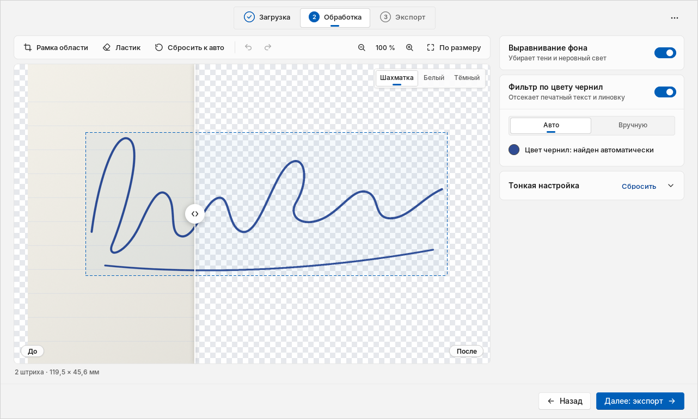
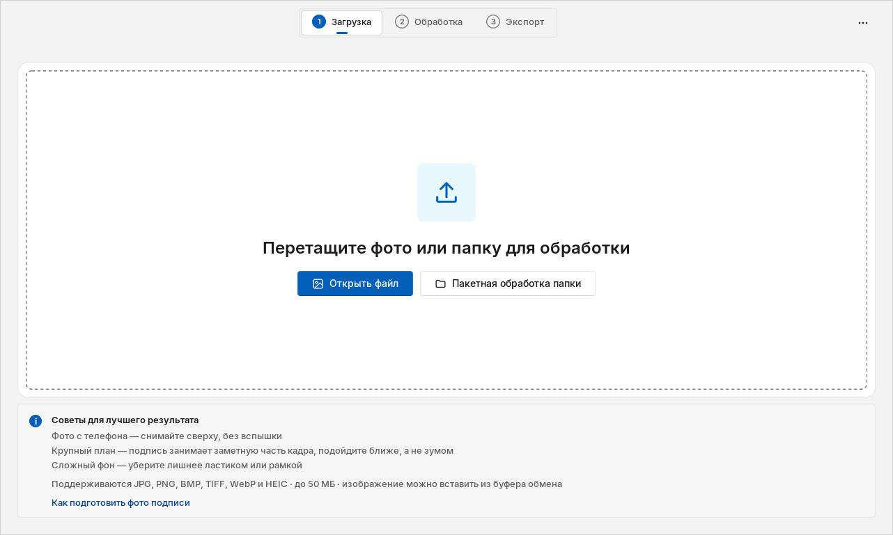
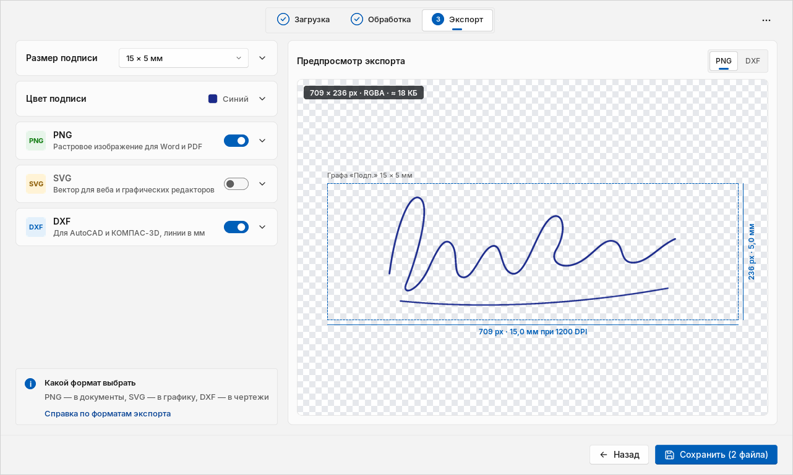
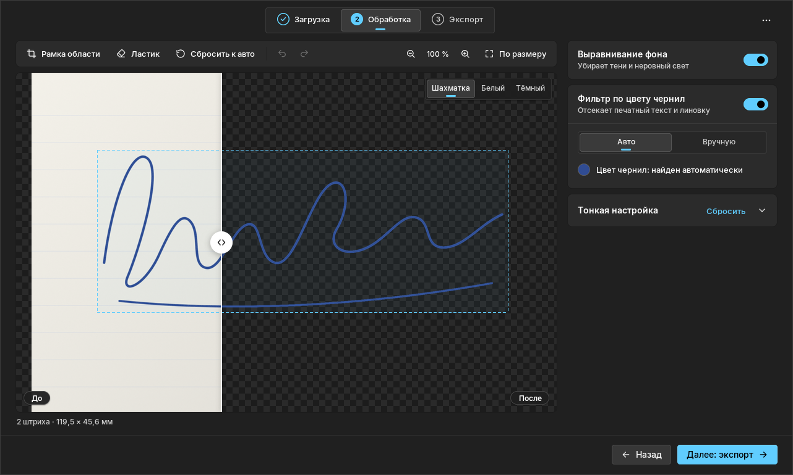

[English](README.md) | **Русский**

<p align="center">
  
</p>

<h1 align="center">Извлечение подписи</h1>

<p align="center">Превращает фото или скан подписи в чистый файл PNG, SVG или DXF без фона.</p>

<p align="center">
  <a href="https://github.com/stanislau-salavei/signature-extractor/releases/latest"></a>
  <a href="https://github.com/stanislau-salavei/signature-extractor/releases"></a>
  <a href="https://github.com/stanislau-salavei/signature-extractor/actions/workflows/build-installer.yml"></a>
  <a href="LICENSE"></a>
  
</p>

<p align="center">
  <a href="https://github.com/stanislau-salavei/signature-extractor/releases/latest"></a>
</p>

<p align="center"></p>

## Как пользоваться

1. **Загрузка.** Перетащите фото или папку в окно, нажмите «Открыть файл» или вставьте изображение из буфера обмена (Ctrl+V). Поддерживаются JPG, PNG, BMP, TIFF, WebP и HEIC, до 50 МБ.
2. **Обработка.** Программа отделит подпись от фона, теней, линовки и постороннего текста. При необходимости поправьте рамку, сотрите лишнее ластиком или настройте фильтры.
3. **Экспорт.** Выберите форматы, цвет и размер подписи и сохраните файлы.

| 1. Загрузка | 2. Обработка | 3. Экспорт |
|:---:|:---:|:---:|
|  |  |  |

Можно обработать сразу много фото: выберите несколько файлов или целую папку. Светлая и тёмная тема берутся из настроек Windows или задаются в параметрах.

<details>
<summary>Тёмная тема</summary>
<p></p>
</details>

## Форматы

| Формат | Что получится | Для чего |
|---|---|---|
| **PNG** | Растровое изображение с прозрачным фоном, 300, 600 или 1200 DPI (по умолчанию 1200) | Word, Excel, PDF, сканы, электронные письма |
| **SVG** | Вектор, остаётся чётким при любом масштабе; размер записан в миллиметрах; штрихи «Как в оригинале» или «Заданная толщина» (по умолчанию 0,18 мм) | Inkscape, CorelDRAW, Illustrator, Word 2016 и новее, веб |
| **DXF** | Линии заданной толщины, единицы — миллиметры | AutoCAD, КОМПАС-3D, nanoCAD, BricsCAD и другие программы, которые читают DXF |

- **Размер:** «Как в исходнике», **15 × 5 мм** (графа подписи в штампе чертежа, по умолчанию) или свой размер в миллиметрах, который можно сохранить как шаблон.
- **Цвет:** «Как на фото», «Чёрный», «Синий», «Чернильный синий», «Яркий синий» или свой цвет.

## Системные требования

- Windows 10 версии 1809 или новее либо Windows 11, 64-bit.
- Права администратора не нужны: программа ставится только для вашей учётной записи, в `%LOCALAPPDATA%\Programs\Signature Extractor`.
- Установщик — около 46 МБ.

## Вопросы и ответы

**Windows пишет «Система Windows защитила ваш компьютер». Это нормально?**
Да. Установщик не подписан цифровой подписью, поэтому фильтр SmartScreen может предупредить о нём. Нажмите «Подробнее» → «Выполнить в любом случае». К каждой версии приложена контрольная сумма SHA-256 установщика (в файле `.sha256` и в заметках к выпуску), по ней можно проверить скачанный файл.

**Программа куда-нибудь отправляет мои подписи?**
Нет. Все фото обрабатываются на вашем компьютере. Программа ничего не отправляет в интернет. Сеть нужна только для обновлений.

**Как работают обновления?**
Если в параметрах включено «Проверять обновления при запуске» (включено по умолчанию, проверка не чаще раза в день) или вы нажали «Проверить сейчас», программа ищет новую версию здесь, на GitHub. Нажмите «Скачать»: программа скачает установщик, проверит его контрольную сумму SHA-256 и установит обновление. Настройки сохраняются.

**Как сообщить о проблеме?**
В программе: ⋯ › «Параметры» › «Сообщить о проблеме». Откроется новый issue на GitHub, в котором уже указаны версия программы, версия Windows и язык. Можно и самостоятельно [создать issue](https://github.com/stanislau-salavei/signature-extractor/issues). Не прикладывайте фото настоящих подписей: всё, что там публикуется, видно всем.

## Сборка из исходников

Нужен Python 3.12 (эта версия используется в CI).

```bash
pip install -r requirements.txt
python main.py
```

Тесты (тесты, которым нужны личные фото, без них пропускаются):

```bash
pip install -r requirements-dev.txt
python -m pytest -q tests
```

Установщик (Windows x64, Inno Setup 6.6 или новее):

```bash
pip install -r requirements.txt -r packaging/requirements-build.txt -c packaging/constraints-win.txt
python packaging/build.py
```

Получится `dist/SignatureExtractor-<версия>-setup.exe` и файл `.sha256`. GitHub Actions делает то же самое в [`build-installer.yml`](.github/workflows/build-installer.yml).

## Лицензия

[GNU General Public License v3.0](LICENSE). © 2026 Stanislau Salavei
